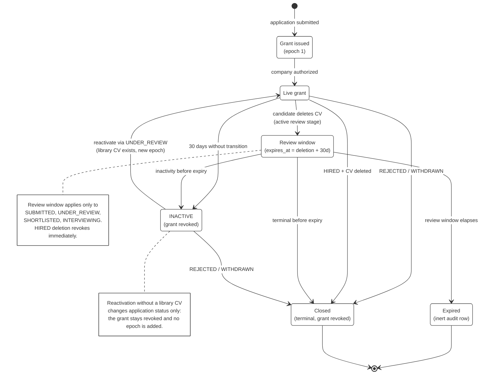
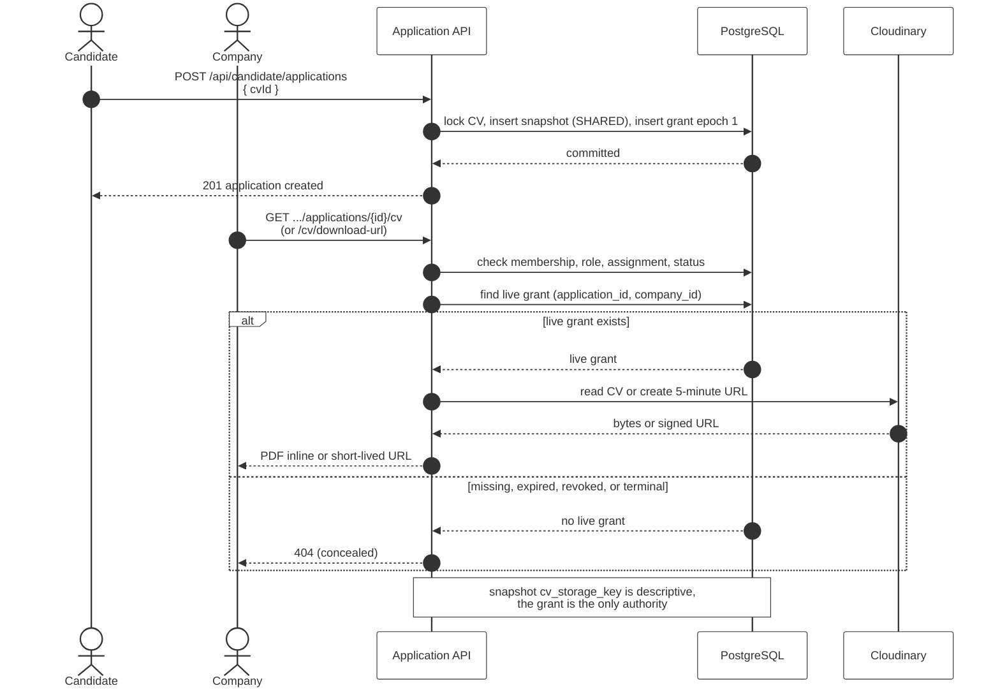
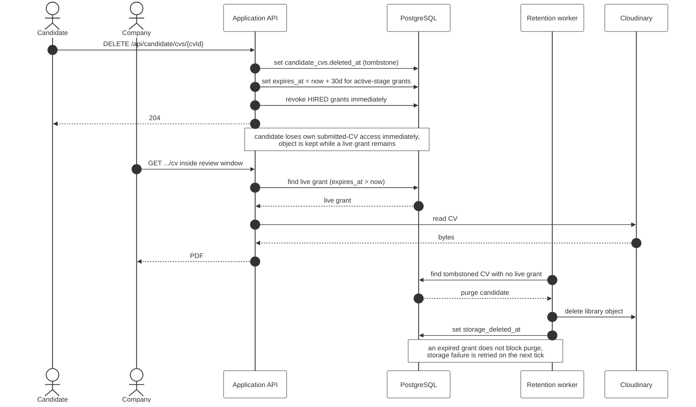
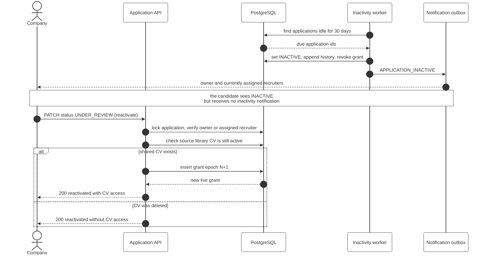
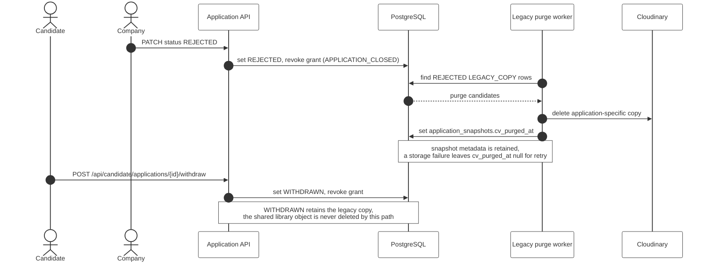

# Sơ đồ access grant cho CV ứng tuyển

Tài liệu này chứa Mermaid source cho vòng đời access grant và các trình tự chính của luồng CV ứng
tuyển. Sơ đồ chỉ mô tả hành vi đã triển khai; GW-SR-CV-02 là nguồn chuẩn khi có mâu thuẫn.

## 1. Vòng đời access grant

## 2. Trình tự: cấp grant và công ty đọc CV

## 3. Trình tự: ứng viên xóa CV và cửa sổ review

## 4. Trình tự: INACTIVE và mở lại đơn

## 5. Trình tự: kết thúc đơn và purge bản sao cũ

## 6. Quy ước đọc sơ đồ

- `SHARED`: đơn tham chiếu CV thư viện; công ty đọc qua grant.
- `LEGACY_COPY`: đơn cũ có bản sao riêng; không backfill grant.
- `Live grant`: `revoked_at IS NULL` và `expires_at` còn hiệu lực.
- `Expired`: grant hết hạn nhưng vẫn là audit row; không cấp quyền.
- `INACTIVE`: đơn bị thu hồi quyền CV; mở lại qua `UNDER_REVIEW` chỉ tạo epoch mới khi CV thư viện
  vẫn tồn tại. Nếu CV đã bị xóa, đơn có thể mở lại nhưng không có quyền đọc CV.
- Mọi trường hợp thiếu grant, grant hết hạn/bị thu hồi, đơn terminal hoặc `INACTIVE` đều trả
  `404` không liệt kê tài nguyên.
