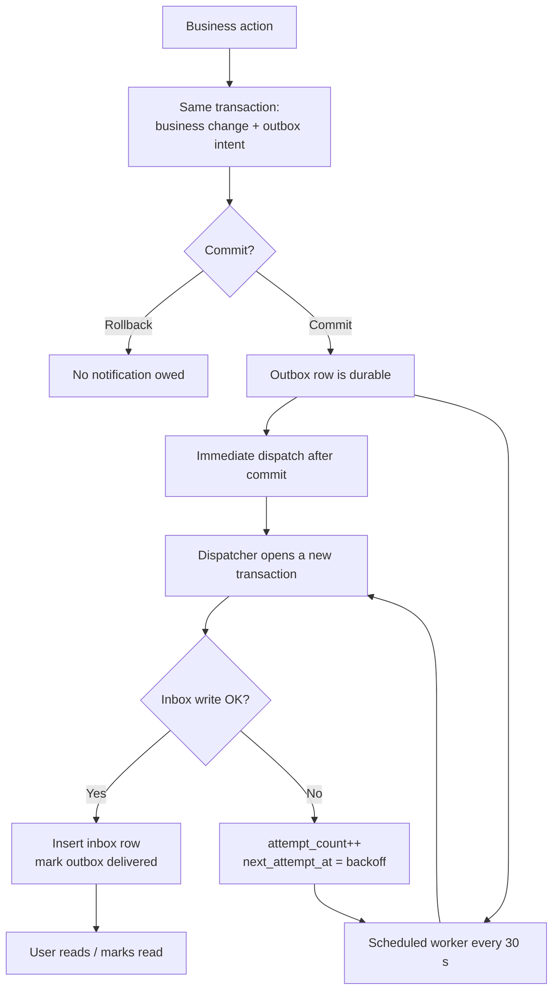

# Notification Outbox and Inbox

This document explains the outbox/inbox pattern used for in-app notifications in `backend/`.

- **Outbox** — `notification_outbox`: a durable record that a notification is owed.
- **Inbox** — `notification_inbox`: the recipient's durable, user-visible copy.

Related: [ADR 0012](../architecture/decisions/0012-notification-outbox-inbox-contract.md) ·
[Notification flow spec](../software-requirements/can/notification-flow-spec.md)

---

## 1. The problem

A business action and its notification are two writes that must not diverge. Each naive approach
fails in a different way:

| Approach | Failure |
|---|---|
| Write the business row, commit, then write the notification | A crash between the two loses the notification after the business action is already final. |
| Write and render both in one transaction | A template or inbox failure rolls back a valid business decision. |
| Hold the notification in memory or a Spring event | A restart loses anything not yet delivered. |
| Retry from memory | A partial failure can create duplicates. |

The constraint is asymmetric: the business decision must not be undone by a notification problem,
the notification must not be lost after commit, and retrying must not duplicate it.

The pattern splits the work into two transactions:

- the **intent** is written with the business change, so it commits or rolls back together;
- the **user-facing copy** is written later, so a delivery failure does not touch the business
  fact and can be retried.

---

## 2. The pattern

### 2.1 Transactional outbox

The outbox is a table in the same database as the business data. The business transaction inserts
the intent row next to the business change:

```text
BEGIN
  UPDATE company_memberships ...        -- business fact
  INSERT INTO notification_outbox ...   -- intent, same transaction
COMMIT
```

The row contains only what is needed to reproduce the event later: event identity, recipient,
event type, context, and delivery metadata such as `attempt_count` and `next_attempt_at`. It is
**not** the user-facing notification.

This gives one guarantee: either both writes commit or both roll back. It becomes impossible for
the business action to succeed while the system forgets that a notification is owed. It does not
make the notification visible yet; it makes the obligation durable.

### 2.2 Dispatcher (the relay)

A separate transaction reads the outbox row, builds the outgoing representation, and delivers it.
Because it is separate from the business transaction:

- a delivery failure cannot roll back the business fact;
- a crash before delivery leaves a durable row that can be retried;
- delivery can run immediately after commit or later from a scheduled worker.

In a distributed system this role is often played by a CDC connector or relay service. Here it is
`NotificationDispatcher`, because sender and receiver share one PostgreSQL database.

### 2.3 Inbox as a read model

The inbox is the recipient's durable copy: rendered title, body, category, action link, and read
state. The dispatcher writes it once, at delivery time.

The inbox deliberately duplicates context from the outbox (`company_name`, job/application IDs,
created time) so that:

- historical notifications do not change when a company is renamed or a template is edited;
- the read path queries one table and joins no business model.

This is the difference between queue state and user-facing state: the outbox owns retries and
delivery metadata; the inbox owns presentation and read state. Their lifecycles are different, so
they are kept in separate tables.

### 2.4 Idempotency and duplicate protection

Delivery is **at-least-once**: the dispatcher may attempt the same event more than once. The
receiver must therefore be idempotent. GuardWork uses three layers:

1. `notification_outbox.event_id` is a UUID created when the intent is recorded.
2. The dispatcher checks `existsBySourceEventId(eventId)` before inserting.
3. `notification_inbox.source_event_id` is `UNIQUE` and references the outbox event.

The existence check avoids the common duplicate. The unique constraint is the final guard if two
dispatchers race. The dispatcher also locks the outbox row with `PESSIMISTIC_WRITE`, so concurrent
deliveries of the same event serialize.

The result: at-least-once delivery, but at most one inbox row per event.

### 2.5 Terminology

In classic messaging, an *inbox* usually means a consumer-side deduplication table: the consumer
stores message IDs so it can ignore repeats. GuardWork's `notification_inbox` is different: it is
the **user-visible read model**. It carries the deduplication identity (`source_event_id`) and
also owns presentation and read state.

### 2.6 What the pattern guarantees

| Guarantee | Meaning |
|---|---|
| **Atomic at record time** | The intent commits or rolls back with the business fact. |
| **Isolated at delivery time** | A failed inbox write becomes retry state, not a business failure. |
| **Crash-safe** | Undelivered intents are durable and findable by the worker. |
| **Duplicate-safe** | Unique event identity prevents a second inbox copy. |
| **Stable history** | Copy is rendered once; later renames and template edits do not rewrite it. |
| **Cheap reads** | The inbox query reads one table and joins no business model. |

---

## 3. End-to-end overview



---

## 4. How GuardWork applies it

| Component | Job |
|---|---|
| `NotificationIntentService` | Writes the outbox intent inside the business transaction. |
| `NotificationDispatcher` | Reads the outbox, renders copy, writes the inbox, records retries. |
| `NotificationTemplate` | Holds the title/body/link for each event type. |
| `MembershipNotificationWorker` | Polls undelivered outbox rows and retries them. |
| `NotificationInboxService` | Lists the user's inbox and marks items read. |

### Flow

1. **Business service records an intent.** It calls `NotificationIntentService.record*()` while its
   transaction is active (`Propagation.MANDATORY`). This inserts one `notification_outbox` row
   with the event ID, recipient, context, and `next_attempt_at = now`.

2. **Business transaction commits.** The notification is now durable even if the process crashes.

3. **Dispatch runs after commit.** Callers use `afterCommit()` or call the dispatcher after a
   `TransactionTemplate` returns. Dispatch opens a new transaction.

4. **Dispatcher delivers.** It locks the outbox row, skips it if already delivered, renders the
   template, inserts the inbox row, and sets `delivered_at`. The inbox insert and delivery marker
   commit together.

5. **Failures become retries.** If delivery fails, the outbox row gets `attempt_count++`,
   `next_attempt_at` with backoff (30 s up to 30 min), and `error_category`. The business action is
   not affected.

6. **Worker recovers missed events.** Every 30 seconds by default, it finds due outbox rows
   (`delivered_at IS NULL`, `next_attempt_at <= now`) and dispatches them. This covers crashes and
   failed immediate dispatches. The same path retries every event type.

7. **Reads use only the inbox.** `GET /api/me/notifications` reads the caller's inbox rows. Marking
   read sets `read_at` once on the caller's own row.

### Read endpoints (P0+P1 + audience)

All endpoints require an authenticated active User and never expose another recipient's rows.
One User can be both a Candidate and a company member, so every endpoint accepts optional
`audience` (`CANDIDATE`/`RECRUITER`); portals pass theirs (`can` → `CANDIDATE`,
`rec` → `RECRUITER`). Omitted returns the all-audience inbox (backwards compatibility).
Detail/single-read return `40406` for cross-audience IDs; unknown `audience` → `40000`.

| Endpoint | Purpose |
|---|---|
| `GET /api/me/notifications` (+ `page`, `size`, `read`, `category`, `eventType`, `sinceId`, `audience`) | Paginated list with server-side filtering. `read=false` = unread, `read=true` = read. `sinceId` returns only `id > sinceId` for polling. Unknown `category`/`eventType`/`audience` or negative `sinceId` → `40000 INVALID_INPUT`. |
| `GET /api/me/notifications/unread-count` (+ `audience`) | `{ unreadCount }` for badge/tab counts (don't derive from a single page). |
| `GET /api/me/notifications/{id}` (+ `audience`) | One recipient-owned item (detail view / deep-link check). Missing/foreign/cross-audience → `40406`. |
| `PATCH /api/me/notifications/{id}/read` (+ `audience`) | Mark one row read (`read_at` set once, idempotent). |
| `PATCH /api/me/notifications/read` (+ `audience`) | Mark every unread row read in one transaction; returns `{ updatedCount, readAt }`. Replaces client per-item fan-out. |

No schema migration accompanies these read endpoints.
`audience` itself is added by `V2026.11.09.105__notification_audience.sql` (frozen intent
context, backfilled by event kind: `APPLICATION_STATUS_CHANGED`/`APPLICATION_REJECTED` →
`CANDIDATE`, everything else including `APPLICATION_WITHDRAWN` → `RECRUITER`).

### Data rules

- Outbox context is immutable after insert.
- Once delivered, outbox retry fields are immutable.
- Inbox context and rendered copy are immutable.
- `read_at` can be set once.
- One outbox event can produce at most one inbox row (`source_event_id` is unique).

---

## 5. What it changes for the team

**User-visible**

- Notifications appear shortly after the action, not necessarily in the same instant. Failed
  deliveries retry after 30 seconds at minimum and 30 minutes at maximum between attempts.
- Notification text and links are frozen when delivered. Later company renames or template edits
  do not rewrite history.
- Users only ever see their own inbox.

**Business code**

- Notification problems never fail or roll back a committed business action.
- Services record typed intents; they do not render notification text.

**Operations**

- Pending work is visible in the outbox table (`attempt_count`, `next_attempt_at`,
  `error_category`).
- Recovery does not replay the business action; the worker or operator replay handles the event.
- No message broker or extra infrastructure is required.

**Trade-offs**

- Every event is stored twice on purpose.
- Delivery is at-least-once; the unique inbox identity prevents duplicates.
- Delivered outbox rows are not pruned yet.
- Actor fields exist but are not populated by current business flows, so real notifications return
  `actor: null`.

---

## 6. Rules for contributors

- Record notifications only through `NotificationIntentService`, inside the business transaction.
- Do not write `notification_inbox` directly; only the dispatcher delivers.
- Add a new event by updating `NotificationEventType`, `NotificationTemplate`, the allowed
  `record*` method, and the database `CHECK` in a new Flyway migration.
- Dispatch after commit, not inside the business transaction.
- Do not mutate outbox context or inbox snapshots; database triggers reject it.
- Tests should assert post-commit delivery, not same-transaction visibility.

---

## 7. Key files

- `backend/src/main/java/com/guardwork/backend/notification/`
- `backend/src/main/resources/db/migration/V8__membership_notifications.sql`
- `backend/src/main/resources/db/migration/V2026.11.03.101__application_review_history_and_notifications.sql`
- `backend/src/main/resources/db/migration/V2026.11.08.104__notification_inbox_envelope.sql`
