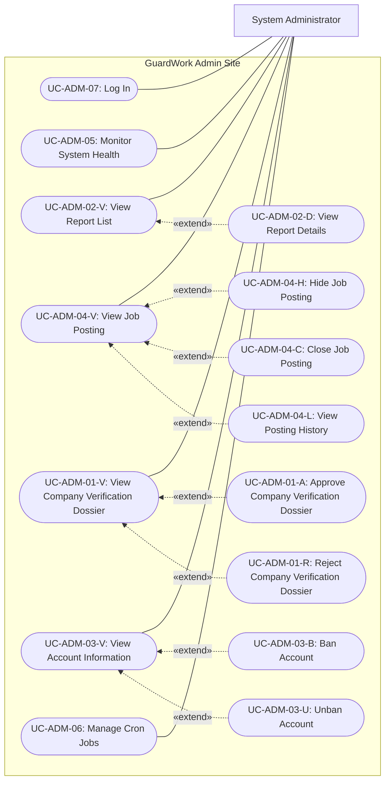

# Admin Site Use Cases

| Field | Value |
|---|---|
| Work item | GW-62 — Write and enhance use cases for the Admin site |
| Status | Draft — diagram-aligned documentation; unresolved contracts are listed in Section 7 |
| Last updated | 2026-10-18 |
| Primary actor | System Administrator (Platform Admin) |
| Source | User-provided Admin use-case diagram for GW-62 |

## 1. Purpose and scope

This document describes the Admin site according to the supplied diagram: seven directly associated use cases and eight optional extensions. Technical prose is English; the traceability table retains the Vietnamese diagram labels. The diagram typos “Mở bài khoản” and “xác mình” are normalized to “Mở khóa tài khoản” and “xác minh”.

The actor is a Platform Admin, distinct from an Owner or Admin within a Company Workspace. Platform authority does not automatically grant Company membership or unrestricted access to private recruitment data. Passwords, password hashes, tokens, and unrelated private communications must not be exposed. Report evidence is accessible only within the authorized report context.

This is a use-case description, not an approval of new authorization rules, API contracts, schemas, dependencies, or infrastructure. Existing approved requirements continue to apply. No implementation or delivery status is implied by a use case appearing here.

### 1.1 Related documents

- [Admin requirements](spec.md): draft functional requirements, operational scope, and MVP phasing.
- [RBAC matrix](rbac_matrix.md): existing role matrix; see the role-boundary conflict in Section 7.
- [Company verification guide](company_verification.md): supporting review context; approved verification requirements take precedence.
- [Company verification specification](../../software-requirements/rec/company-verification-spec.md): approved verification rules and coordination notes.
- [Authentication specification](../../software-requirements/auth/authentication-authorization-spec.md): approved login and Platform/Company role separation.
- [Job Publishing specification](../recruiters/job-publishing-spec.md): draft publication lifecycle and Company/Platform capability boundaries.

### 1.2 Existing identifier compatibility

Existing references in `spec.md` use `UC-ADM-01` for Company Verification, `UC-ADM-02` for Report Resolution, `UC-ADM-03` for Ban/Unban, and `UC-ADM-04` for Job Takedown. These identifiers remain workflow references, not reassigned diagram nodes. Suffixed IDs below identify individual diagram nodes within those feature areas. `UC-ADM-05` and `UC-ADM-06` retain their existing meanings; `UC-ADM-07` adds Login.

Report resolution remains described in `spec.md`; its absence from this diagram does not remove that workflow from the wider requirements.

## 2. Diagram inventory and traceability

All use cases have the System Administrator as their primary actor. Only Login can begin without an authenticated Admin session. Read-only use cases do not authorize a state change.

| ID | Use case | Diagram label | Relationship | Existing requirement reference |
|---|---|---|---|---|
| UC-ADM-07 | Log In | Đăng nhập | Direct actor association | Authentication: REQ-AUTH-03, REQ-AUTH-04, REQ-AUTH-10 |
| UC-ADM-05 | Monitor System Health | Giám sát sức khỏe hệ thống | Direct actor association | ADM-MON-01–04 |
| UC-ADM-02-V | View Report List | Xem danh sách báo cáo | Direct actor association | ADM-REP-01 |
| UC-ADM-02-D | View Report Details | Xem chi tiết báo cáo | Extends UC-ADM-02-V | Report review context; standalone read contract needs clarification |
| UC-ADM-04-V | View Job Posting | Xem tin tuyển dụng | Direct actor association | Job moderation context; administrative read scope needs clarification |
| UC-ADM-04-H | Hide Job Posting | Ẩn tin tuyển dụng | Extends UC-ADM-04-V | ADM-JOB-01–06 |
| UC-ADM-04-C | Close Job Posting | Đóng tin tuyển dụng | Extends UC-ADM-04-V | Draft Admin lifecycle; conflicting role boundary, see Section 7 |
| UC-ADM-04-L | View Posting History | Xem lịch sử đăng tin | Extends UC-ADM-04-V | GW-JP-039 preserves history; Admin read scope needs clarification |
| UC-ADM-01-V | View Company Verification Dossier | Xem hồ sơ xác minh công ty | Direct actor association | Company verification: REQ-REC-02, REQ-REC-03 |
| UC-ADM-01-A | Approve Company Verification Dossier | Phê duyệt hồ sơ xác minh công ty | Extends UC-ADM-01-V | Company verification: REQ-REC-04, REQ-REC-06–08 |
| UC-ADM-01-R | Reject Company Verification Dossier | Từ chối hồ sơ xác minh công ty | Extends UC-ADM-01-V | Company verification: REQ-REC-05–08 |
| UC-ADM-03-V | View Account Information | Xem thông tin tài khoản | Direct actor association | Account governance context; administrative read scope needs clarification |
| UC-ADM-03-B | Ban Account | Khóa tài khoản | Extends UC-ADM-03-V | ADM-BAN-01–04, ADM-BAN-07 |
| UC-ADM-03-U | Unban Account | Mở khóa tài khoản | Extends UC-ADM-03-V | ADM-BAN-05–07 |
| UC-ADM-06 | Manage Cron Jobs | Quản lý Cron job | Direct actor association | ADM-CRON-01–05 |

The Admin requirements referenced above are Draft. A traceability reference does not promote a draft rule to Approved. Company verification references use the approved dedicated specification and its coordination notes.

## 3. Use-case relationships

The following Mermaid flowchart records the supplied use-case associations and extension directions. It is a relationship view, not an execution sequence. Every dashed arrow points from the extending use case to its base use case.

Each base use case can complete without invoking an extension. An extension is available only when its guard is satisfied. Login is a separate use case and an authentication precondition for the other use cases; the diagram contains no `include` relationship.

| Extending use case | Base use case | Extension point | Guard |
|---|---|---|---|
| View Report Details | View Report List | Report selection | Admin chooses an accessible report |
| Hide Job Posting | View Job Posting | Job moderation actions | Admin chooses Hide; job is eligible for takedown |
| Close Job Posting | View Job Posting | Job lifecycle actions | Admin chooses Close; authority and eligible states must be resolved before implementation |
| View Posting History | View Job Posting | History selection | Admin chooses history; access scope is authorized |
| Approve Company Verification Dossier | View Company Verification Dossier | Verification decision | Admin chooses Approve; dossier is `PENDING` |
| Reject Company Verification Dossier | View Company Verification Dossier | Verification decision | Admin chooses Reject; dossier is `PENDING` |
| Ban Account | View Account Information | Account enforcement actions | Admin chooses Ban; target is eligible under the applicable policy |
| Unban Account | View Account Information | Account enforcement actions | Admin chooses Unban; target has an active ban |

## 4. Directly associated use cases

### 4.1 UC-ADM-07 — Log In

- **Trigger:** The Admin opens the Admin site and submits credentials.
- **Preconditions:** An existing account is eligible to authenticate. Admin access requires Platform role `ADMIN`.
- **Main flow:**
  1. The Admin enters username or email and password.
  2. The system authenticates the account using the existing authentication contract.
  3. The system establishes the authenticated session and permits Admin access only after verifying Platform authority.
- **Alternatives:** Invalid credentials or an ineligible account do not establish access. An authenticated non-Admin is denied administrative access. An expired session requires authentication before protected work continues.
- **Postconditions:** On success, the Admin can access authorized Admin functions. Authentication does not change Company membership or grant Company roles.

### 4.2 UC-ADM-05 — Monitor System Health

- **Trigger:** The Admin opens system monitoring.
- **Preconditions:** An authenticated Platform Admin session; configured monitoring sources are available.
- **Main flow:**
  1. The system obtains infrastructure and traffic metrics from the configured monitoring sources.
  2. The system displays CPU, JVM memory, threads, database connection metrics, CCU, request rate, and error rate where available.
  3. The Admin reviews or refreshes the displayed information.
- **Alternatives:** Unavailable metrics are identified as unavailable; they must not be presented as healthy or as zero activity.
- **Postconditions:** Metrics are displayed without changing business records. Monitoring must not impose heavy scans on the primary transactional database.
- **Delivery note:** The Admin Draft places custom monitoring at P2/Post-MVP. This document does not select a monitoring architecture.

### 4.3 UC-ADM-02-V — View Report List

- **Trigger:** The Admin opens the report list.
- **Preconditions:** An authenticated Platform Admin session.
- **Main flow:**
  1. The system retrieves the authorized report queue.
  2. The Admin may filter by report status and target type as described by ADM-REP-01.
  3. The system displays matching reports, or an empty result when none match.
  4. At **Report selection**, the Admin may invoke View Report Details.
- **Alternatives:** Retrieval failure is reported without changing report state.
- **Postconditions:** The list is displayed. Viewing the list does not resolve, reject, or sanction a report.

### 4.4 UC-ADM-04-V — View Job Posting

- **Trigger:** The Admin selects a job posting for inspection.
- **Preconditions:** An authenticated Platform Admin session; the target is within the authorized administrative read scope.
- **Main flow:**
  1. The system retrieves the selected posting and its current lifecycle/moderation state.
  2. The system displays the posting information permitted for administrative review.
  3. At **Job moderation actions**, the Admin may invoke Hide Job Posting.
  4. At **Job lifecycle actions**, the diagram offers Close Job Posting, subject to the unresolved authority in Section 7.
  5. At **History selection**, the Admin may invoke View Posting History.
- **Alternatives:** Missing or inaccessible targets are handled under the applicable access contract. A failed read does not change the posting.
- **Postconditions:** The Admin has inspected the posting. Private Company notes, applicant data, and communications are not implicitly included.

### 4.5 UC-ADM-01-V — View Company Verification Dossier

- **Trigger:** The Admin opens Company verification and selects a dossier.
- **Preconditions:** An authenticated Platform Admin session.
- **Main flow:**
  1. The system provides the verification queue with the filtering, pagination, and FIFO ordering defined by the approved verification specification.
  2. The Admin selects a Company dossier.
  3. The system displays the submitted profile, tax code, legal evidence, verification status, and current version within the applicable verification contract.
  4. The Admin reviews the evidence. At **Verification decision**, the Admin may invoke Approve or Reject for a `PENDING` dossier.
- **Alternatives:** An empty queue is displayed explicitly. Missing/unavailable evidence prevents a supported decision and must not be treated as verified. Non-pending dossiers cannot receive another decision through these extensions.
- **Postconditions:** The dossier is inspected; no verification decision is made unless an extension succeeds.

### 4.6 UC-ADM-03-V — View Account Information

- **Trigger:** The Admin selects an account for governance review.
- **Preconditions:** An authenticated Platform Admin session; the target falls within the authorized account-read scope.
- **Main flow:**
  1. The system identifies the target type: user account or Company, matching the existing governance scope.
  2. The system displays permitted identifying information, current status, and relevant ban information.
  3. At **Account enforcement actions**, the Admin may invoke Ban or Unban when eligible.
- **Alternatives:** Missing or inaccessible targets are handled under the applicable access contract. Sensitive credentials and unrelated private communications are never returned.
- **Postconditions:** The target has been inspected. No account state or permissions change from reading alone.

### 4.7 UC-ADM-06 — Manage Cron Jobs

- **Trigger:** The Admin opens Cron job management.
- **Preconditions:** An authenticated Platform Admin session; registered background jobs exist.
- **Main flow:**
  1. The system displays registered jobs, schedules, active/paused status, and last execution information.
  2. The Admin selects a job and inspects execution history or error logs.
  3. When authorized, the Admin may trigger an asynchronous manual execution, adjust the schedule, or pause/resume the job.
  4. The system records the administrative action and displays its accepted result or updated configuration. An accepted trigger is not reported as a completed run.
- **Alternatives:** An invalid schedule, unavailable worker, or failed operation is reported without claiming success. Execution failure appears in execution history.
- **Postconditions:** Read-only inspection leaves configuration unchanged. Successful changes and manual triggers are attributable to the acting Admin.
- **Delivery note:** The Admin Draft places custom Cron management at P3/Post-MVP. This document does not choose a scheduler or add new diagram nodes for its internal operations.

## 5. Extending use cases

### 5.1 UC-ADM-02-D — View Report Details

- **Base / trigger:** View Report List, at Report selection, when the Admin selects a report.
- **Preconditions:** The report exists and is accessible to the authenticated Platform Admin.
- **Main flow:** The system loads the report target, submitted reason, authorized evidence, current status, and any existing review outcome; the Admin inspects the details and may return to the list.
- **Alternatives:** Missing/inaccessible reports or unavailable evidence are reported without changing the report outcome. Unauthorized private data is excluded.
- **Postconditions:** Report details are displayed. This use case does not itself select a sanction, resolve the report, or reject it. Whether opening details begins `IN_REVIEW` and acquires the Draft review lock needs clarification in Section 7.

### 5.2 UC-ADM-04-H — Hide Job Posting

- **Base / trigger:** View Job Posting, at Job moderation actions, when the Admin chooses Hide.
- **Preconditions:** The target is currently `PUBLISHED` and eligible for administrative takedown.
- **Main flow:** The Admin supplies the mandatory takedown reason and submits the action. The system rechecks authority and current state, changes the posting to `SUSPENDED`, records the responsible Admin and moderation time, records the audit entry, and applies the search/cache removal required by the governing contract.
- **Alternatives:** Missing reason, ineligible state, or a conflicting update prevents a successful takedown. Failure must not be reported as successful hiding.
- **Postconditions:** On success, the posting is suspended and unavailable through ordinary Candidate discovery/access under the moderation contract; its evidence and history are preserved.
- **Meaning:** “Hide” maps to the existing Admin takedown concept, not Company pause or physical deletion. Search/cache technology remains governed by the applicable approved contract.

### 5.3 UC-ADM-04-C — Close Job Posting

- **Base / trigger:** View Job Posting, at Job lifecycle actions, when the Admin chooses Close.
- **Preconditions:** The diagram proposes Platform Admin closure; the authority and eligible source states are unresolved. This description is not implementation authorization.
- **Proposed flow:** Once the governing contract is approved, the Admin submits closure; the system validates authority and eligibility and closes the posting under that contract.
- **Alternatives:** While authority remains unresolved, the diagram alone must not enable this operation. Ineligible or stale targets cannot be reported as successfully closed.
- **Intended postconditions:** The posting is `CLOSED`, new Applications stop, and existing Applications and posting history remain intact. Closing is distinct from enforcement suspension.
- **Conflict:** See Section 7 before implementing or amending the authorization contract.

### 5.4 UC-ADM-04-L — View Posting History

- **Base / trigger:** View Job Posting, at History selection, when the Admin chooses to inspect history.
- **Preconditions:** The Admin is authorized to read the target posting's history; exact scope remains to be specified.
- **Main flow:** The system displays available posting/revision and publication/moderation events within that scope, including recorded status changes, decision reasons, actors, and times where applicable. The Admin reviews the history and returns to the posting.
- **Alternatives:** No history is displayed as an empty result. Retrieval failure is distinguished from an empty history. Internal Company notes and unrelated applicant records are excluded unless independently authorized.
- **Postconditions:** History is inspected without editing events or restoring an earlier posting state.

### 5.5 UC-ADM-01-A — Approve Company Verification Dossier

- **Base / trigger:** View Company Verification Dossier, at Verification decision, when the Admin chooses Approve.
- **Preconditions:** The dossier is `PENDING`; the Admin has reviewed the submitted evidence and supplies the current `expectedVersion`.
- **Main flow:** The system rechecks authority, status, and version; changes verification status to `VERIFIED`; records reviewer/time; increments the version; and records the immutable decision audit entry within the decision transaction. Decision notification follows the applicable verification requirement.
- **Alternatives:** A non-pending dossier is rejected under the existing contract. A stale version returns a concurrency conflict and requires reloading. A failed decision transaction must not leave a successful approval or audit claim.
- **Postconditions:** On success, the decision and audit record are persisted. Company eligibility follows the governing onboarding/membership contract; approval does not grant Platform Admin authority.
- **Notification note:** Verification-decision delivery is separately deferred in the verification coordination notes; this document does not claim that it is implemented or choose a delivery provider.

### 5.6 UC-ADM-01-R — Reject Company Verification Dossier

- **Base / trigger:** View Company Verification Dossier, at Verification decision, when the Admin chooses Reject.
- **Preconditions:** The dossier is `PENDING`; the Admin supplies the current `expectedVersion` and a non-blank rejection reason of 10–1000 characters.
- **Main flow:** The system validates the reason, authority, status, and version; sets verification status to `REJECTED`; retains the reason; increments the version; and records the immutable decision audit entry within the transaction. Decision notification follows the same governing contract and delivery limitation as approval.
- **Alternatives:** Invalid reasons, non-pending state, stale versions, or transaction failure prevent a successful rejection.
- **Postconditions:** On success, the rejection and actionable feedback are retained. Later Owner correction/resubmission follows the existing Company identity and history-preservation rules and is outside this Admin diagram.

### 5.7 UC-ADM-03-B — Ban Account

- **Base / trigger:** View Account Information, at Account enforcement actions, when the Admin chooses Ban.
- **Preconditions:** The target user or Company exists and is eligible under the enforcement policy. The Admin cannot ban their own account.
- **Main flow:** The Admin supplies the target, reason, and optional expiry. The system rechecks authority and target state, records the ban, updates the target's enforcement status, invalidates access as required, and records the audit entry. A Company ban follows the applicable policy for linked recruiter access and published postings.
- **Alternatives:** Missing reason, self-ban, ineligible state, or failed mandatory enforcement steps must not be reported as a successful ban.
- **Postconditions:** On success, the target is banned and the required access restrictions are effective. History is preserved; a ban does not delete the target.
- **Contract boundary:** Redis/transaction mechanics in the Admin Draft are not selected or approved by this use-case update.

### 5.8 UC-ADM-03-U — Unban Account

- **Base / trigger:** View Account Information, at Account enforcement actions, when the Admin chooses Unban.
- **Preconditions:** The target has an active ban; the Admin supplies an unban reason.
- **Main flow:** The system validates authority and active ban state, deactivates the ban, restores the target's applicable active/non-banned state, and records the unban audit entry. Authentication follows the governing token-revocation contract; old sessions are not automatically restored.
- **Alternatives:** No active ban, missing reason, conflicting state, or failed mandatory enforcement steps prevents a successful unban.
- **Postconditions:** On success, the active ban is lifted and its history remains. Unbanning does not automatically verify a Company or republish suspended postings.

## 6. Shared safeguards and verification scenarios

Every protected action must check Platform authority, including direct requests that bypass the Admin interface. Every mutation must recheck the current target state and preserve an attributable audit record. Approved concurrency, privacy, and authentication requirements take precedence over UI assumptions. Canceling an extension before submission leaves business state unchanged.

Documentation review scenarios:

1. Each of the 15 supplied diagram nodes maps to exactly one inventory row and one use-case description.
2. Seven direct actor associations and eight extension arrows match the supplied diagram; no `include` relationship is introduced.
3. Base read flows can finish without invoking an extension. Reading a report does not imply resolving it.
4. Non-Admins cannot access protected functions; Company Admin authority alone does not grant Platform governance.
5. Company approval/rejection requires `PENDING` and the current version; rejection requires the documented reason length.
6. Hide, Close, and history inspection have distinct outcomes; no operation deletes posting/Application history.
7. Ban/Unban cannot bypass enforcement eligibility, audit, or applicable token rules.
8. Monitoring/worker failures are visible; missing metrics and accepted asynchronous work are not shown as successful completion.
9. Unresolved contracts below remain visible and are not silently implemented through this documentation change.

These are review scenarios, not claims that backend behavior has been implemented or tested by GW-62.

## 7. Requirement conflicts and scope boundaries

| Topic | Existing evidence | Treatment in this document / required follow-up |
|---|---|---|
| Platform Admin closing jobs | The supplied diagram includes Close. The Admin Draft lifecycle includes `CLOSED`; the older RBAC matrix grants inherited close capability. The Job Publishing Draft explicitly denies Platform Administrator pause/resume/close and reserves it for authorized Company members. | Preserve Close as a proposed diagram use case. Human reconciliation of authority and eligible states is required before implementation; no approved contract is amended here. |
| Platform versus Company authority | The older RBAC matrix models role inheritance. The approved Authentication specification separates Platform role from Company membership authority (BR-AUTH-06). | Platform Admin is the actor here; Company rights are not inferred. Review the older matrix before relying on inherited permissions. |
| Administrative read scope | The diagram adds explicit job, account, report-detail, and posting-history reads. Preserving history in GW-JP-039 does not itself define Platform read permission. | Document the requested goals without choosing new API routes or field-level access contracts. Specify and approve private-field visibility and history scope before implementation. |
| Opening report details | ADM-REP-02 describes a lock when review begins; this diagram describes viewing details without a separate Begin Review action. | Do not assume a read resolves a report or starts a review. Clarify whether detail opening starts review and acquires the Draft lock. |
| Report resolution | Existing UC-ADM-02/ADM-REP-04–07 includes resolution, rejection, and sanctions; the supplied diagram includes only list/detail views. | Keep resolution in the wider requirements and outside this diagram's inventory. This edit does not de-scope it from the product. |
| Other wider workflows | The Admin Draft includes audit-log search; the Job Publishing Draft includes approval/rejection of posting revisions. Neither appears in the supplied diagram. | Do not add extra nodes to this diagram or remove those workflows from their source documents. Reconcile coverage when defining the full Admin product scope. |
| Operational delivery | Custom health monitoring is P2/Post-MVP and Cron management is P3/Post-MVP in the Admin Draft. | Diagram inclusion does not change priority or commit these features to MVP delivery. |
| Verification notification | Approved verification requirements call for decision notifications; coordination notes explicitly defer their delivery. | Retain the requirement and disclose the delivery gap; do not claim existing implementation or introduce a transport/provider. |

This update changes only the Admin use-case document. It does not change runtime behavior, APIs, persistence, migrations, or dependencies, and does not approve a new security or infrastructure architecture.
